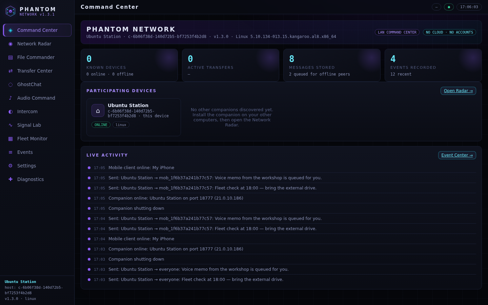
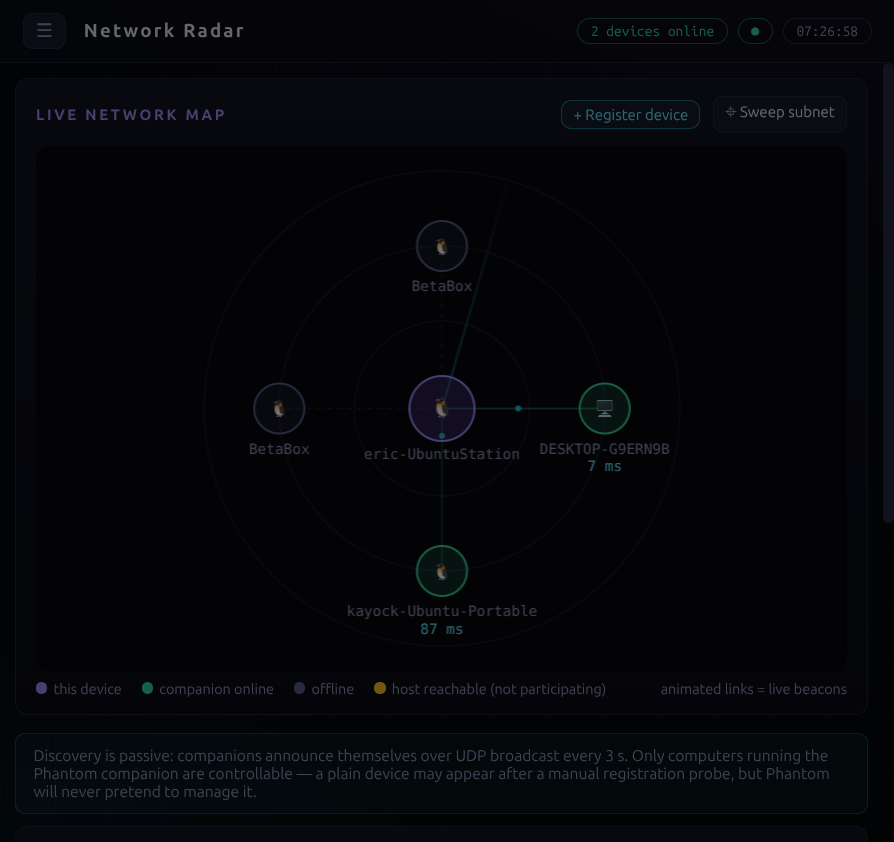
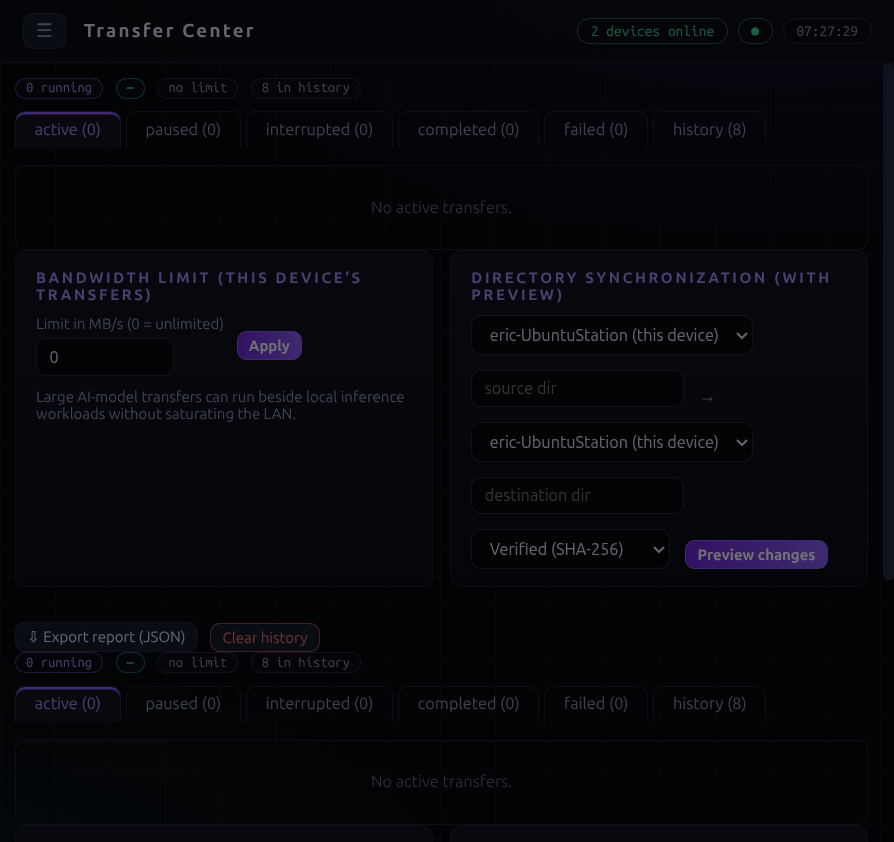

# PHANTOM NETWORK v1.3.1

**Cross-Platform LAN Command Center, File Commander & Signal Laboratory**

*Every machine. Every signal. One command center.*

Phantom Network turns three or more computers on a private LAN into a
coordinated fleet: a futuristic browser command center with network radar,
a dual-pane File Commander across machines, SHA-256 verified file transfers,
private GhostChat messaging, remote audio playback, push-to-talk intercom,
and an audio Signal Laboratory — **with no cloud, no accounts, no Docker,
and no AI model required**.

```
┌──────────────┐   UDP beacons + HTTP    ┌──────────────┐
│ Ubuntu Station│◄──────────────────────►│  Windows PC  │
│ companion:8415│   direct transfers      │ companion:8415│
└──────┬───────┘                         └──────┬───────┘
       │            ┌──────────────┐            │
       └───────────►│ Ubuntu Portable│◄──────────┘
                    │ companion:8415 │   any machine can open the
                    └──────────────┘   browser command center
```

- **Privacy-first sharing**: since v1.1.0 Phantom Network shares **nothing** by default — a
  first-run wizard authorizes directories or whole drives explicitly
  (read-only or read-write).
- **Companion** — a lightweight Python service on every participating
  computer (pure standard library; optional `psutil`). It serves the web UI,
  discovers peers over UDP, browses authorized directories, runs verified
  transfers, relays chat/intercom and reports telemetry.
- **Command center** — a browser UI served by every companion at
  `http://<machine>:8415/`. Open it from any participating computer or a
  phone browser. Twelve views: Command Center, Network Radar, File
  Commander, Transfer Center, GhostChat, Audio Command, Intercom, Signal
  Lab, Fleet Monitor, Events, Settings, Diagnostics.
- **Large-file transfers** — physically verified on a private LAN through
  **50 GB** with independent SHA-256 checks, pause/resume, and roughly
  **7–9 MiB/s** throughput at about **43–45 MB** companion RSS. External
  volumes (for example a 1 TB ext4 drive) can be authorized as dedicated
  transfer directories. v1.3.1 fixes cold source-checksum timeouts so huge
  files no longer need a manual hash-cache warm-up before the first pull.

## Screenshots

<p align="center">
  
</p>

<p align="center">
  
</p>

<p align="center">
  
</p>

## Quick start (three-computer LAN)

1. **Install the companion** on each computer:
   - Ubuntu: `sudo bash packaging/install-ubuntu.sh`
   - Windows (Admin PowerShell): `powershell -ExecutionPolicy Bypass -File packaging\install-windows.ps1`
2. **Open the command center**: `http://localhost:8415` on any of them
   (or from a phone: `http://<desktop-ip>:8415`).
3. Other companions appear in the **Network Radar** automatically within
   seconds (UDP broadcast). Devices on other subnets can be added by IP
   with *Radar → + Register device*.
4. Fire up **File Commander**, pick a different machine in each pane, and
   copy/move files — every transfer is streamed, chunked and SHA-256
   verified (see the Transfer Center).

Full instructions incl. firewall notes, portable mode and uninstallation:
[DEPLOYMENT.md](DEPLOYMENT.md).

## Ports

| Port | Protocol | Purpose |
|---|---|---|
| 8415/tcp | HTTP | API + web UI + SSE + file transfer (configurable) |
| 8414/udp | UDP | discovery beacons (broadcast + multicast) |

Nothing else is opened; no firewall rules are modified automatically.
If your firewall blocks discovery, allow those two ports — DEPLOYMENT.md
lists the exact commands (`ufw`, `firewalld`, Windows Defender).

## Privacy & participation model

- Only computers **you** install the companion on are controllable.
  Discovered plain hosts are listed but explicitly marked *not
  participating* and never faked as manageable.
- Directory access is sandboxed to **authorized shares** configured per
  device (Settings → Authorized directories). Path traversal and symlink
  escapes are rejected server-side.
- Every capability (remote audio, intercom, monitoring, transfers,
  messaging) can be switched off per device.
- No telemetry leaves the LAN. Events are stored locally in `events.jsonl`.
- No covert features: microphone capture happens only in your browser while
  the intercom push-to-talk button is held; remote audio playback has a
  visible on/off control on each device.

## Documentation

| File | Contents |
|---|---|
| [ARCHITECTURE.md](ARCHITECTURE.md) | modules, data flow, protocol choices |
| [API_REFERENCE.md](API_REFERENCE.md) | every REST endpoint + SSE events |
| [DEVELOPER_GUIDE.md](DEVELOPER_GUIDE.md) | dev setup, coding rules, testing |
| [DEPLOYMENT.md](DEPLOYMENT.md) | install, firewall, TLS, auto-start |
| [FILE_TRANSFER_PROTOCOL.md](FILE_TRANSFER_PROTOCOL.md) | chunking, resume, verification, move safety |
| [HARDWARE_COMPATIBILITY.md](HARDWARE_COMPATIBILITY.md) | target machines + measured performance |
| [BUILD.md](BUILD.md) | build/package from source, reproducibility |
| [CHANGELOG.md](CHANGELOG.md) | version history |
| [TEST_REPORT.md](TEST_REPORT.md) | what was actually tested and results |
| [BUILD_LOG.txt](BUILD_LOG.txt) | the actual build/verification log |
| [KNOWN_LIMITATIONS.md](KNOWN_LIMITATIONS.md) | honest limitations |
| [DEVELOPMENT_BACKLOG.md](DEVELOPMENT_BACKLOG.md) | future improvements |
| [LICENSE](LICENSE) | MIT + third-party notices |

## License

MIT — see [LICENSE](LICENSE). All sound presets and artwork are original
synthesized/vector assets created for this project (no copyrighted material).


---

## PHANTOM MOBILE (current release)

Phones and tablets are now **independent participants**: open `/m` (or scan
the QR in Settings → Add Mobile Device), pick a device name, and the phone
registers with its own identity, inbox and presence — hosted and relayed by
a companion, with no phone-side server and no cloud service.

- Mobile interface: bottom navigation, chat, devices, files, voice notes.
- PWA: installable, offline shell, update detection. `web/sw.js` never
  caches `/api/**`.
- GhostChat 2.0 between computers and phones; delivery means the phone
  acknowledged — not merely that its host received the message.
- Fleet: All Devices overview, storage views (useful/physical/all),
  capability badges, discovery diagnostics, peer exchange.
- Automation: watched folders and scheduled verified copies (additive,
  never deletes). Monitoring alerts with thresholds, hold time, cooldown.
- Optional HTTPS for mic/PWA secure contexts (HTTPS_SETUP.md).

See MOBILE_CLIENT_GUIDE.md, UPGRADE_GUIDE.md and CHANGELOG.md.
